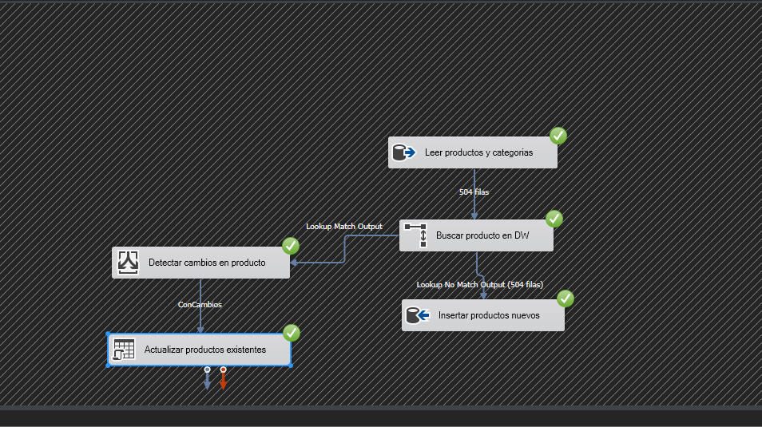

# Validación de CargaProducto

Ejecuté las pruebas en SQL Server 2019, instancia `BAKKAPO\BIT2019`, con origen `BikeZ` y destino `BikeZ_DW`. Revisé los resultados en SSMS y comprobé la actualización durante la ejecución local. La captura adjunta corresponde a la primera carga.

| Prueba | Resultado |
|---|---|
| Primera carga | Ejecuté el paquete y se insertaron 504 productos. Comprobé que DimProducto quedó con 505 filas, incluyendo el miembro -1. |
| Datos faltantes | Comprobé que había 248 productos con "Sin color informado" y 209 con CategoriaID nulo. |
| Segunda ejecución | Volví a ejecutar el paquete y comprobé que los conteos se mantuvieron en 505, 504, 1, 248 y 209. |
| Actualización SCD tipo 1 | Cambié el color del ProductoID 1 a "Prueba SCD1" en el DW. Ejecuté el paquete y comprobé que volvió a "Sin color informado", conservó su ProductoKey y el total siguió en 505. |

Hice el cambio temporal en el DW y mantuve los datos de BikeZ. Al terminar la prueba, comprobé que el color quedó nuevamente con el valor del origen.

## Cómo funciona

El origen une Productos y Categorias con LEFT JOIN y completa los textos faltantes. El Lookup busca por ProductoID: los nuevos se insertan y los existentes se comparan con una división condicional. Si cambió un atributo, un comando OLE DB actualiza la fila por ProductoKey sin cambiar esa clave. Los registros sin cambios no se actualizan.

## Alcance

Estas pruebas corresponden solo a DimProducto. Las demás dimensiones, FactVentas, la conciliación completa y el respaldo final siguen pendientes. Para ejecutar el paquete usé Run64BitRuntime = False por el error COM de la extensión SSIS 4.0.
