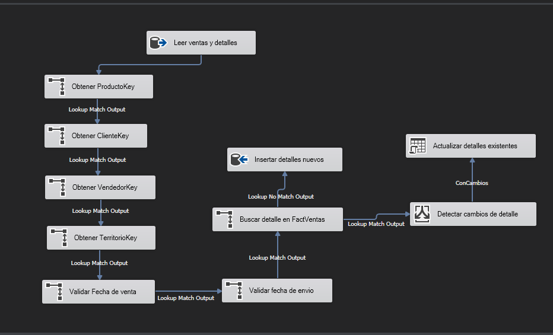

# Validación de FactVentas

Ejecuté `CargarFactVentas.dtsx` en SQL Server 2019, instancia `BAKKAPO\BIT2019`, después de cargar las cinco dimensiones. Revisé los resultados en SSMS.

| Prueba | Resultado |
|---|---|
| Primera carga | Comprobé 121.317 detalles, 31.465 ventas distintas y 27.658 ventas distintas con VendedorKey = -1. |
| Segunda ejecución | Volví a ejecutar el paquete y obtuve los mismos tres conteos. |
| Actualización de un detalle | Consulté el importe de VentaID 43659 y DetalleVentaID 1, lo aumenté temporalmente en 1 en el DW y ejecuté el paquete. Comprobé que volvió al importe inicial y que el total siguió en 121.317 detalles. |

El cambio temporal se hizo únicamente en BikeZ_DW y ya quedó restaurado con el valor del origen. Las ventas sin vendedor se cuentan por VentaID distinto, no por cantidad de detalles.

## Flujo implementado

La captura muestra la configuración del flujo. Los resultados de ejecución están registrados en la tabla anterior.

- Uní Ventas y DetalleVentas por VentaID, conservando una fila por VentaID y DetalleVentaID.
- Calculé las claves de fecha AAAAMMDD, ImporteVenta como cantidad por precio y DiasDespacho como diferencia de días entre venta y envío. Usé decimal(19,4) para los importes.
- Convertí los ID nulos de vendedor y territorio a -1. Los Lookup resuelven ProductoKey, ClienteKey, VendedorKey y TerritorioKey; el de Vendedor incluye el miembro desconocido.
- Validé ambas fechas contra DimFecha. Si una clave o fecha no tiene coincidencia, el componente falla y permite revisar el error en Progreso.
- Busqué los hechos existentes usando conjuntamente VentaID y DetalleVentaID. Los nuevos se insertan; una división condicional compara las seis claves y las cuatro medidas de los existentes, incluyendo los nulos de DiasDespacho.
- Los detalles con cambios se actualizan por las dos columnas de su clave; los que están iguales se conservan sin actualización.

## Pendientes

Falta la revisión de Frank y ejecutar su conciliación de cantidades e importes en ambos equipos. También falta probar CargaCompleta, registrar el tratamiento de errores para la entrega y preparar el respaldo final. Estas pruebas individuales no cierran la validación completa de la Fase 1.

## Estado posterior al registro inicial

Las observaciones anteriores conservan el alcance de la prueba original. La conciliación, el respaldo y la confirmación de cierre de CargaCompleta ya están registrados en [el cierre de la Fase 1](10_cierre_fase1.md), actualizado el 14 de octubre de 2026.
